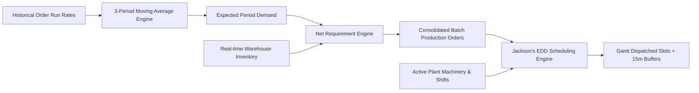
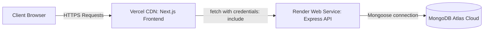

# 🏭 Factory Brain v2.0
### Autonomous Shop Floor Planning, Demand Forecasting & Machine Sequencing SaaS

[](https://nextjs.org/)
[](https://expressjs.com/)
[](https://www.mongodb.com/)
[](https://www.typescriptlang.org/)
[](https://tailwindcss.com/)
[](https://opensource.org/licenses/MIT)

> **Factory Brain** is an industry-agnostic, full-stack manufacturing execution and orchestration platform designed to replace fragmented spreadsheets. It bridges the critical operational divide between commercial demand and shop-floor machinery through an **autonomous 3-stage computational pipeline**: **Demand Forecasting $\rightarrow$ Net Requirement Planning $\rightarrow$ Earliest Due Date (EDD) Machine Sequencing**.

---

## 📌 Table of Contents
1. [Core Architectural Pipeline](#-core-architectural-pipeline)
2. [Key Features & Functional Highlights](#-key-features--functional-highlights)
3. [System Architecture & Data Flow](#-system-architecture--data-flow)
4. [Tech Stack](#-tech-stack)
5. [Mathematical & Algorithmic Foundations](#-mathematical--algorithmic-foundations)
6. [Database Schema Models](#-database-schema-models)
7. [API Specification & Endpoints](#-api-specification--endpoints)
8. [Folder Structure](#-folder-structure)
9. [Local Development & Setup](#-local-development--setup)
10. [Production Deployment Guide (Vercel + Render + Atlas)](#-production-deployment-guide-vercel--render--atlas)
11. [Security & Cross-Origin Credentials Architecture](#-security--cross-origin-credentials-architecture)

---

## ⚙️ Core Architectural Pipeline

Traditional manufacturing plants suffer from either machine idle time, unexpected overtime costs, or stockout cancellations. Factory Brain links three deterministic engines into one unified operational loop:



1. **Stage 1: Demand Forecasting**
   - Ingests multi-period historical SKU runs.
   - Computes expected demand using a 3-Period Moving Average with automated confidence scoring ($85\%$ for 3 full historical periods).
2. **Stage 2: Net Requirement Planning (MRP)**
   - Computes: $\text{Net Requirement} = \max(0, \text{Forecast} - \text{Warehouse Stock on Hand})$.
   - Aggregates multi-size SKUs into a single unified batch order per product style, avoiding tool-changeover fragmentation.
3. **Stage 3: Machine Scheduling & Gantt Dispatching**
   - Implements Jackson's Earliest Due Date (EDD) algorithm to minimize maximum job lateness ($L_{\max}$).
   - Dispatches work packets only onto operational machines (`isOperational: true`) and automatically sequences 15-minute maintenance buffers between shifts.

---

## 🚀 Key Features & Functional Highlights

### 📊 Live Executive Dashboard
- **Real-Time KPI Cards:** Active production orders, operational machines ratio, and critical stockout warnings.
- **Production Status Distribution:** Interactive visual status breakdown rendered via Recharts.
- **Shop-Floor Capacity Load:** Live machine utilization indicators with automatic warning states.
- **Active Alert Feed:** Direct visibility into line items that drop below verified safety thresholds.

### 📦 Product & SKU Matrix Management
- Multi-tier product catalog supporting variable size matrices (e.g., S, M, L, XL).
- Cycle-time modeling: Defines `machineMinutesPerUnit` and `materialQtyPerUnit` per SKU.
- Optimistic active/inactive state toggles and soft deletions.

### 🏭 Inventory Ledger & Reorder Triggers
- Real-time stock on hand tracking against configurable minimum reorder points.
- Visual fill-percentage gauges (Safe, Warning, Critical Out-of-Stock).
- Inline table editing for rapid cycle counts without modal context-switching.

### 📈 Demand Forecasting Suite
- Interactive period selector (`YYYY-MM`) with sample historical data templates.
- Color-coded SKU breakdown charts and tabular statistical summaries.
- Confidence classification rules: $85\%$ for 3 periods, $60\%$ for 2 periods, $40\%$ for 1 period.

### 📋 Production Orders Engine
- Multi-state finite state machine: `pending` $\rightarrow$ `in-progress` $\rightarrow$ `completed` (with `cancelled` fallback).
- Expandable batch orders revealing full SKU size distributions and total run-hour estimations.
- One-click Net Requirement Planning calculation directly from target forecast periods.

### 🗓️ Gantt Machine Schedule & Capacity Analytics
- Daily timeline slot ledger with start times, end times, and duration minutes.
- Shift utilization analysis classified into:
  - **Idle (0%):** Under-utilized line capacity.
  - **Normal (1% – 75%):** Healthy, sustainable production pacing.
  - **High (76% – 100%):** Peak floor efficiency.
  - **Over-Scheduled (>100%):** Bottleneck warning signaling overtime or secondary shift requirements.

### ⚙️ Plant Asset & Machine Registry
- Equipment asset catalog with per-machine shift duration allocations (default: 480 minutes / 8 hours).
- One-click maintenance downtime toggle (`isOperational`) to immediately exclude malfunctioning equipment from the dispatch pool.

---

## 🏗️ System Architecture & Data Flow

```
┌────────────────────────────────────────────────────────┐
│                   Next.js 16 (Client)                  │
│       App Router (SSR + Client Hydration)              │
│       Tailwind CSS v4 + SWR Data Fetching + Recharts   │
└───────────────────────────┬────────────────────────────┘
                            │
               HTTPS + credentials: 'include'
               (Cross-Origin Cookie: fb_token)
                            │
                            ▼
┌────────────────────────────────────────────────────────┐
│               Express.js 4 (REST API Engine)           │
│       - Auth Middleware (JWT Verification & RBAC)      │
│       - Multi-Tenant Scoping (userId query injection)   │
│       - Planning, Forecasting & Scheduling Services    │
└───────────────────────────┬────────────────────────────┘
                            │
               Mongoose ORM Connection
                            │
                            ▼
┌────────────────────────────────────────────────────────┐
│                   MongoDB Atlas Cloud                  │
│       Users, Products, Inventory, Forecasts,           │
│       ProductionOrders, Machines, ScheduleSlots        │
└────────────────────────────────────────────────────────┘
```

---

## 💻 Tech Stack

| Layer | Technology | Selection Rationale |
|---|---|---|
| **Frontend Framework** | **Next.js 16.4 (App Router)** | Hybrid SSR prerendering, dynamic route groups `(dashboard)` & `(auth)`. |
| **Frontend Language** | **TypeScript 5.0** | Strict type-safety, shared data-transfer interfaces, clean builds. |
| **Styling & Design** | **Tailwind CSS v4** | Dark industrial surface palette, custom responsive utility grid. |
| **Data Fetching** | **SWR (Stale-While-Revalidate)** | Automatic cache invalidation, optimistic UI mutations, revalidation. |
| **Data Visualization** | **Recharts 3.x** | SVG-rendered horizontal bar capacity loads, Gantt slots, and trend bars. |
| **Iconography** | **Lucide React** | Clean industrial UI icons with zero runtime bloat. |
| **Backend Runtime** | **Node.js 20+ (ES Modules)** | Modern ECMAScript module standard (`import`/`export`). |
| **API Framework** | **Express.js 4** | Lightweight, high-throughput REST routing with middleware architecture. |
| **Database & ODM** | **MongoDB Atlas + Mongoose 8** | Flexible document modeling for complex nested matrices and aggregation pipelines. |
| **Authentication** | **JWT + HTTP-Only Cookies** | Secure token storage resisting XSS and CSRF attacks. |

---

## 🧮 Mathematical & Algorithmic Foundations

### 1. 3-Period Moving Average Forecast
For each product SKU $i$ across three consecutive historical demand intervals ($p_1, p_2, p_3$):

$$\hat{D}_i = \left\lceil \frac{p_{1,i} + p_{2,i} + p_{3,i}}{3} \right\rceil$$

### 2. Net Requirement Derivation (MRP)
For target period demand $\hat{D}_i$ and current warehouse stock on hand $S_i$:

$$N_i = \max(0, \hat{D}_i - S_i)$$

If $N_i > 0$, order generation combines all sizes belonging to the parent product $P$ into a single production batch order:

$$\text{Total Order Run Time} = \sum_{j \in P} \left( N_j \times \text{machineMinutesPerUnit}_j \right)$$

### 3. Earliest Due Date (EDD) Scheduling & Capacity
Jobs are ordered such that:

$$\text{dueDate}(J_1) \le \text{dueDate}(J_2) \le \dots \le \text{dueDate}(J_n)$$

Each job $J_k$ is dispatched to the earliest available operational machine:

$$\text{startTime}(J_k) = \max(\text{machineFreeTime}(M), \text{shiftStart})$$
$$\text{endTime}(J_k) = \text{startTime}(J_k) + \text{duration}(J_k)$$
$$\text{machineFreeTime}(M) = \text{endTime}(J_k) + 15\text{ minutes (Setup Buffer)}$$

Machine Utilization Percentage across an $S$-minute shift:

$$\text{Utilisation } \% = \left( \frac{\sum \text{duration}(J)}{S} \right) \times 100$$

---

## 🗄️ Database Schema Models

Every collection is strictly indexed and multi-tenant isolated via `{ userId: ObjectId }`.

| Model | Schema Details | Indexes |
|---|---|---|
| **User** | `username`, `email`, `password` (bcrypt), `company: { name, industry, numMachines }`, `role: 'admin'\|'manager'\|'viewer'`, `isVerified`, `otp` | `{ email: 1 }`, `{ username: 1 }` |
| **Product** | `userId`, `name`, `category`, `isActive`, `sizes: [{ sizeLabel, sku, machineMinutesPerUnit, materialQtyPerUnit }]` | `{ userId: 1, 'sizes.sku': 1 }` |
| **Inventory** | `userId`, `productId`, `sizeId`, `sku`, `quantityOnHand`, `reorderPoint` | `{ userId: 1, sku: 1 }` |
| **DemandForecast** | `userId`, `sku`, `productId`, `sizeId`, `forecastPeriod` (YYYY-MM), `forecastQty`, `method`, `confidencePct` | `{ userId: 1, forecastPeriod: 1, sku: 1 }` |
| **ProductionOrder** | `userId`, `orderNumber`, `productId`, `status: 'pending'\|'in-progress'\|'completed'\|'cancelled'`, `dueDate`, `items: [...]` | `{ userId: 1, dueDate: 1 }`, `{ orderNumber: 1 }` |
| **Machine** | `userId`, `name`, `type`, `shiftMinutes` (default: 480), `isOperational`, `notes` | `{ userId: 1, name: 1 }` |
| **ScheduleSlot** | `userId`, `productionOrderId`, `orderNumber`, `machineId`, `machineName`, `startTime`, `endTime`, `durationMinutes`, `status` | `{ userId: 1, scheduleDate: 1 }` |

---

## 📡 API Specification & Endpoints

All application routes (except public health and login) require valid JWT cookie authorization.

### Authentication (`/api/auth`)
- `POST /api/auth/register` — Create company account & dispatch 6-digit OTP.
- `POST /api/auth/verify-otp` — Validate registration OTP and mark account verified.
- `POST /api/auth/login` — Authenticate credentials and issue `httpOnly` `fb_token` cookie.
- `POST /api/auth/logout` — Expire and clear auth cookie.
- `GET /api/auth/me` — Return current authenticated session profile.

### Core Resources (`/api/products`, `/api/inventory`, `/api/machines`)
- `GET /api/products` — List user's product catalog.
- `POST /api/products` — Create product and auto-initialize inventory records per size.
- `PATCH /api/products/:id` — Update product details or active toggle.
- `DELETE /api/products/:id` — Soft-delete product (`isActive: false`).
- `GET /api/inventory` — Return inventory ledger with populated product names.
- `GET /api/inventory/alerts` — Query records where `quantityOnHand <= reorderPoint`.
- `PUT /api/inventory/:sku` — Idempotently update verified stock count and threshold.
- `GET /api/machines` — List all registered shop-floor machines.
- `POST /api/machines` — Register new production machinery.
- `PATCH /api/machines/:id` — Update machine specs or toggle operational status.
- `DELETE /api/machines/:id` — Delete machine asset.

### Planning Engines (`/api/forecast`, `/api/orders`, `/api/schedule`, `/api/dashboard`)
- `POST /api/forecast/generate` — Calculate 3-period moving average forecast from JSON payload.
- `GET /api/forecast?period=YYYY-MM` — Query historical or saved forecasts by period.
- `POST /api/orders/generate` — Execute Net Requirement Planning and construct batch orders.
- `GET /api/orders` — List production orders sorted by Earliest Due Date.
- `PATCH /api/orders/:id/status` — Advance order through state machine.
- `POST /api/schedule/generate` — Run EDD sequencing engine for target schedule date.
- `GET /api/schedule?date=YYYY-MM-DD` — Retrieve Gantt timeline blocks for date.
- `GET /api/schedule/utilization?date=YYYY-MM-DD` — Retrieve per-machine capacity load percentages.
- `GET /api/dashboard/summary` — Aggregated KPI metrics for dashboard view.

---

## 📂 Folder Structure

```
factory-brain/
├── api/                             # Node.js + Express REST API Backend
│   ├── src/
│   │   ├── config/
│   │   │   ├── db.js                # MongoDB Atlas connection
│   │   │   └── seed.js              # Demo seed data script
│   │   ├── controllers/            # Route controllers for all business logic
│   │   ├── middlewares/            # JWT auth guard & error handlers
│   │   ├── models/                 # 7 Mongoose domain models
│   │   ├── routes/                 # Express endpoint routers
│   │   ├── services/               # Forecast, Planning & Scheduling engines
│   │   └── app.js                  # Server configuration and middleware pipeline
│   ├── .env                         # Backend environment secrets
│   └── package.json
│
├── web/                             # Next.js 16 App Router Frontend
│   ├── src/
│   │   ├── app/
│   │   │   ├── (auth)/             # Route group: Glassmorphism Login & Register
│   │   │   ├── (dashboard)/        # Route group: Sidebar & Topbar Shell
│   │   │   │   ├── dashboard/      # Live KPI metrics & charts
│   │   │   │   ├── products/       # Product catalog & matrix management
│   │   │   │   ├── inventory/      # Real-time stock ledger & alerts
│   │   │   │   ├── forecast/       # 3-period moving average forecasting
│   │   │   │   ├── orders/         # Net requirement batch orders
│   │   │   │   ├── schedule/       # Machine Gantt timeline & load
│   │   │   │   └── machines/       # Plant machinery asset registry
│   │   │   ├── globals.css         # Industrial dark theme design system
│   │   │   ├── layout.tsx          # Root layout with AuthProvider wrapper
│   │   │   └── page.tsx            # SaaS Landing Page
│   │   ├── components/             # Reusable UI components (Sidebar, Topbar)
│   │   ├── contexts/               # AuthContext for global user session state
│   │   └── lib/                    # apiRequest fetch wrapper & SWR hooks
│   ├── .env.local                   # Frontend API URL configuration
│   └── package.json
│
├── INTERVIEW_QUESTIONS.md           # 73 In-depth Full-Stack Interview Questions
└── README.md                        # Master Documentation
```

---

## 💻 Local Development & Setup

### Prerequisites
- **Node.js:** v18.0.0 or higher
- **MongoDB:** Active MongoDB Atlas URI or local instance
- **Git**

### 1. Clone the Repository
```bash
git clone https://github.com/kapiilgupta/factory-brain.git
cd factory-brain
```

### 2. Configure Backend (`api/`)
```bash
cd api
npm install
```

Create `api/.env`:
```env
PORT=4000
NODE_ENV=development
MONGODB_URI=mongodb+srv://<USER>:<PASSWORD>@<CLUSTER>.mongodb.net/factory-brain?retryWrites=true&w=majority
JWT_SECRET=your_super_secret_jwt_key_min_32_characters_long
JWT_EXPIRES_IN=7d
COOKIE_MAX_AGE=604800000
CLIENT_ORIGIN=http://localhost:3000
```

Seed initial manufacturing demo data:
```bash
node src/config/seed.js
```

Start backend development server:
```bash
npm run dev
# Running on http://localhost:4000
```

### 3. Configure Frontend (`web/`)
In a separate terminal:
```bash
cd web
npm install
```

Create `web/.env.local`:
```env
NEXT_PUBLIC_API_URL=http://localhost:4000
```

Start frontend development server:
```bash
npm run dev
# Running on http://localhost:3000
```

### 4. Access the Application
1. Open your browser to `http://localhost:3000`.
2. Click **Operator Sign In** (or navigate to `http://localhost:3000/login`).
3. Click **Quick Fill Demo Manager Credentials** and sign in.

---

## 🌐 Production Deployment Guide (Vercel + Render + Atlas)

Factory Brain is engineered for a cloud-native, decoupled deployment architecture:
- **Frontend (`web/`):** Deployed to **Vercel** (Global Edge CDN, automatic SSR builds).
- **Backend (`api/`):** Deployed to **Render** (Continuous deployment from Git, health monitoring).
- **Database:** **MongoDB Atlas** (Managed cloud cluster).



### Step 1: Deploy Backend to Render
1. Create a free account on [Render.com](https://render.com/).
2. Click **New +** $\rightarrow$ **Web Service**.
3. Connect your GitHub repository: `kapiilgupta/factory-brain`.
4. Configure service settings:
   - **Root Directory:** `api`
   - **Environment:** `Node`
   - **Build Command:** `npm install`
   - **Start Command:** `npm start`
5. Add **Environment Variables** in Render dashboard:
   ```env
   PORT=10000
   NODE_ENV=production
   MONGODB_URI=mongodb+srv://<USER>:<PASSWORD>@cluster.mongodb.net/factory-brain?retryWrites=true&w=majority
   JWT_SECRET=production_random_secret_at_least_32_characters
   JWT_EXPIRES_IN=7d
   COOKIE_MAX_AGE=604800000
   CLIENT_ORIGIN=https://your-frontend-app.vercel.app
   ```
6. Click **Deploy Web Service** and copy your live URL (e.g., `https://factory-brain-api.onrender.com`).

### Step 2: Deploy Frontend to Vercel
1. Create a free account on [Vercel.com](https://vercel.com/).
2. Click **Add New...** $\rightarrow$ **Project**.
3. Import your GitHub repository: `kapiilgupta/factory-brain`.
4. Configure framework preset:
   - **Framework Preset:** `Next.js`
   - **Root Directory:** Edit and set to `web`
5. Add **Environment Variables** in Vercel project configuration:
   ```env
   NEXT_PUBLIC_API_URL=https://factory-brain-api.onrender.com
   ```
6. Click **Deploy**. Vercel will build and assign your domain (e.g., `https://factory-brain.vercel.app`).

### Step 3: Finalize CORS Handshake
Return to your **Render Web Service** dashboard, edit `CLIENT_ORIGIN`, and set it to your exact Vercel URL:
```env
CLIENT_ORIGIN=https://factory-brain.vercel.app
```
Trigger a quick redeploy on Render. Your live production platform is now operational!

---

## 🔒 Security & Cross-Origin Credentials Architecture

Deploying the frontend on `vercel.app` and backend on `onrender.com` introduces a **cross-site (third-party cookie)** context. Factory Brain handles this securely via:

1. **Cookie Configuration (`api/src/controllers/authController.js`):**
   ```javascript
   const isProd = process.env.NODE_ENV === 'production';
   res.cookie('fb_token', token, {
       httpOnly: true,                                      // Blocks JavaScript XSS access
       secure: isProd,                                      // Transmitted over HTTPS only
       sameSite: isProd ? 'none' : 'lax',                   // 'none' permits cross-domain cookie delivery
       maxAge: 7 * 24 * 60 * 60 * 1000,
   });
   ```
2. **CORS Configuration (`api/src/app.js`):**
   ```javascript
   app.use(cors({
       origin: process.env.CLIENT_ORIGIN,
       credentials: true,                                   // Allows browser to receive and send cookies
   }));
   ```
3. **Frontend Fetch Wrapper (`web/src/lib/api.ts`):**
   Every fetch request automatically specifies `credentials: 'include'`:
   ```typescript
   const config: RequestInit = {
       credentials: 'include',                              // Attaches fb_token cookie cross-origin
       headers: { 'Content-Type': 'application/json' },
       ...
   };
   ```

---

## 🎓 Technical Interview Guide

Building Factory Brain covers extensive full-stack system design, database indexing, state machines, and real-time operations. For technical interview preparation, consult the companion document:

👉 **[INTERVIEW_QUESTIONS.md](./INTERVIEW_QUESTIONS.md)** — **73 In-Depth Questions & Architectural Answers** across:
- ES Modules vs CommonJS runtime dynamics
- MongoDB indexing, compound keys, and sub-document embedding
- Jackson's Earliest Due Date scheduling proofs
- Next.js 16 App Router lifecycle & Turbopack SSR hydration handling
- Cross-origin cookie policies (`SameSite=None` + `Secure`)

---

## 📄 License
This project is open-source under the [MIT License](LICENSE).
